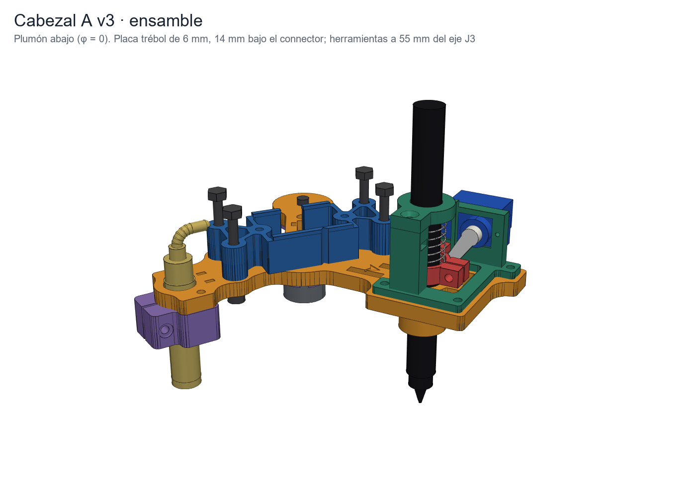
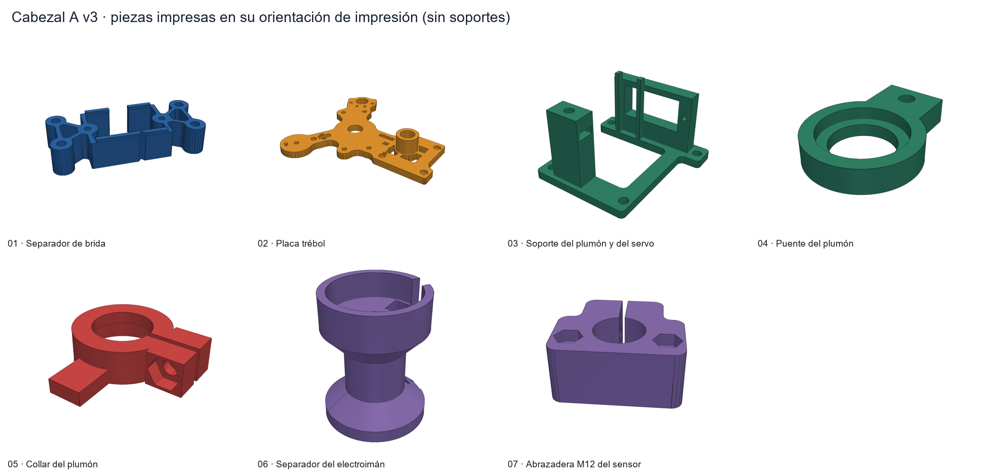
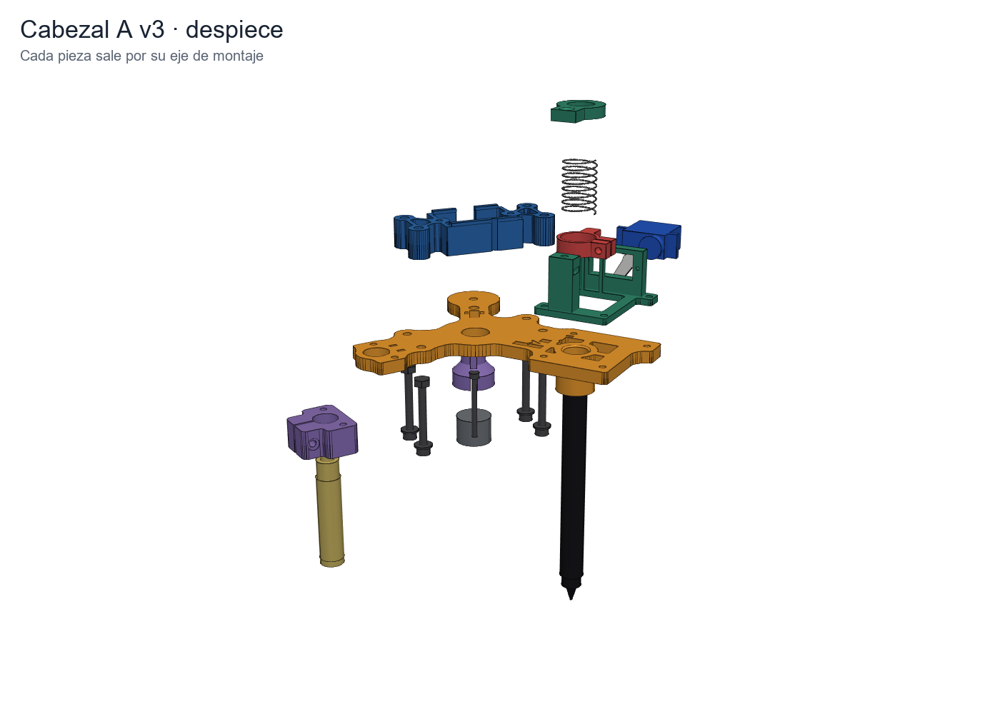
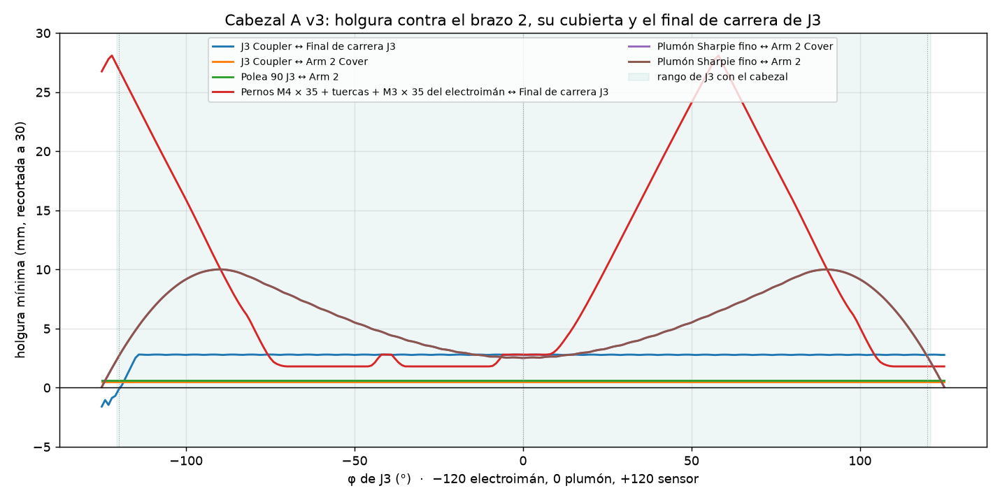
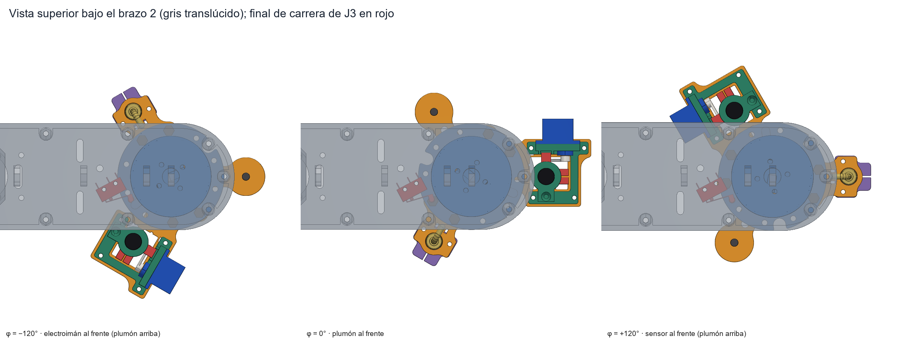

# Cabezal A v3 · disco tri-herramienta (CAD imprimible)

Cabezal del SCARA de MathBot con plumón, electroimán KK-P20/15 y sensor LJ12A3-4-Z/BX a 55 mm del eje de J3 (0° / 120° / 240°), montado en el *Gripper to J3 connector* original en lugar de la pinza de HowToMechatronics.
Parte de la v2 de `anatomia/cabezal/` y la corrige con las medidas reales del ensamble de HTM (ver [Por qué v3](#por-qué-v3)).



| Carpeta / archivo | Qué es |
|---|---|
| `STL/` | 7 piezas en orientación de impresión, sin soportes |
| `STEP/` | Las mismas piezas en el marco del cabezal: origen en el eje de J3, z = 0 en la cara superior de la placa, +x hacia el plumón |
| `ensamble/Cabezal A v3.step` | Subensamble: piezas impresas, compradas y tornillería, plumón abajo |
| `ensamble/SCARA con cabezal de disco.step` | `SCARA Robot 3D Model.STEP` sin la pinza, con el connector, el cabezal y J3 en φ = 0 |
| `ensamble/stl/` | Mallas de cada pieza en posición de ensamble + `meta.json` (levante, horn, resorte), para el despiece del [panel](../../../panel/README.md) |
| `img/` | Vistas PNG (piezas en la cama, ensamble, despiece, levante, J3 a ±120°, robot completo, holguras) |
| `fuente/` | CAD paramétrico en CadQuery y los scripts que exportan, verifican y renderizan |
| `piezas.json`, `verificacion.json` | Gramos y horas por pieza; resultados de las comprobaciones |

## Piezas impresas

| # | Pieza | Material | Perím. / relleno | g | h | Orientación |
|---|---|---|---|---:|---:|---|
| 01 | Separador de brida (14 mm) | PETG | 4 / 40 % | 12.4 | 1.1 | Cejas hacia arriba |
| 02 | Placa trébol 6 mm + guía del plumón | PETG | 3 / 30 % | 31.5 | 2.7 | Boca abajo (cara superior en la cama) |
| 03 | Soporte del plumón y del servo | PETG | 4 / 40 % | 8.1 | 0.7 | Pie en la cama; la ventana del servo es un puente de 23 mm |
| 04 | Puente del plumón | PETG | 4 / 40 % | 1.9 | 0.2 | Boca abajo |
| 05 | Collar del plumón | PETG | 4 / 50 % | 1.8 | 0.2 | Boca abajo (oreja en la cama) |
| 06 | Separador del electroimán (copa) | PLA+ | 3 / 30 % | 6.0 | 0.5 | Brida en la cama; chaflán de 42° |
| 07 | Abrazadera M12 del sensor | PLA+ | 4 / 40 % | 6.1 | 0.5 | Cara de la placa en la cama |
| | **Total** | | | **67.8** | **5.8** | |

Gramos y horas con el mismo modelo de la hoja *Impresión 3D* del presupuesto (paredes y techos de 1.1 mm + 25 % de relleno, 11.7 g/h); el slicer dará algo menos.
El *Gripper to J3 connector* se sigue imprimiendo de `SCARA Robot Arm - STL Files - updated/`.



**Ajustes de impresión.** Capa 0.2 mm, boquilla 0.4. PETG 235–245 °C / cama 75–80 °C; PLA+ 205–215 °C / 60 °C. Sin soportes en ninguna pieza.
Activen la compensación de pata de elefante (0.2 mm): 01, 02, 04 y 05 tienen alojamientos de tuerca o agujeros en la primera capa.

**Holguras de diseño (FDM).**

| Ajuste | Medida en el CAD | Pieza comprada |
|---|---|---|
| Guías del plumón (placa y puente) | Ø12.5 | Sharpie fino Ø12.0 (midan el suyo y cambien `D_PLUMON`) |
| Collar del plumón (se aprieta) | Ø12.2, partido, M3 | |
| Asientos del resorte | Ø16.8 | Resorte Ø16 |
| Copa del electroimán | Ø20.4 × 6 | KK-P20/15 Ø20 × 15 |
| Abrazadera del sensor (se aprieta) / paso en la placa | Ø12.3 / Ø12.8 | LJ12A3 M12 × 1 |
| Ventana de la cuna del servo | 23.0 × 12.6 | SG90 22.5 × 12.2 / MG90S 22.8 × 12.2 |
| Pasantes M3 / M4, guía de las M2 del servo | Ø3.4 / Ø4.5 / Ø1.8 | |
| Alojamientos de tuerca M3 | 5.85 entre caras × 2.8 | DIN 934 M3 (5.5 × 2.4) |
| Cejas piloto del separador | 0.25 por lado | Cintura del connector (23 mm) |

## Tornillería y piezas compradas

| Dónde | Qué | Cant. |
|---|---|---:|
| Placa + separador + connector → brida del J3 Coupler | Perno M4 × 35 DIN 912 + arandela bajo la cabeza + tuerca M4 (con fijador de rosca, **sin** arandela arriba) | 4 |
| Connector → separador (ranuras avellanadas del connector) | M3 × 16 avellanado DIN 7991 + tuerca | 2 |
| Soporte → placa | M3 × 10 DIN 912 + tuerca (alojamiento bajo la placa) | 4 |
| Puente → poste | M3 × 16 avellanado + tuerca (trampa lateral del poste) | 1 |
| Collar (apriete) | M3 × 12 + tuerca | 1 |
| Abrazadera → placa / apriete | M3 × 20 + tuerca | 2 + 1 |
| Electroimán → placa | M3 × 35 (M4 × 35 si su electroimán trae rosca M4: el paso es Ø4.6) | 1 |
| Servo | Los 2 tornillos M2 y el brazo simple que trae el servo | — |
| Resorte del plumón | **Ø15–16 × 30 mm, alambre 0.5–0.6, Ø int. ≥ 13.5, sólido ≤ 6 mm** | 1 |

El resorte de la lista (Ø10–12 × 20) no sirve: no pasa sobre el plumón de Ø12 y 20 mm de largo libre no alcanzan para 18 mm de levante más precarga.
Con el de Ø16 × 30 × 0.6 (≈0.04 N/mm) el plumón traza con ≈0.33 N (resorte 0.2 N + peso 0.13 N) y el servo levanta ≈1 N con el brazo de 16 mm, un 10 % del par del SG90.

## Orden de montaje



1. **Tuercas.** Pongan las tuercas M3 en: separador (2, por abajo), placa (4, por abajo), abrazadera (2 por abajo + 1 lateral), collar (1 lateral) y poste del soporte (1 por la ranura lateral).
2. **Servo.** Pasen el servo por la ventana de la cuna desde +y hasta que las orejas apoyen en la pared; atorníllenlo con sus dos M2. Todavía sin brazo.
3. **Soporte** sobre la placa: 4 × M3 × 10 desde arriba.
4. **Electroimán.** Electroimán en la copa (cables por la ranura del fondo o de la pared y por el canal de la columna); copa bajo la placa con el pasador en su agujero; M3 × 35 desde arriba hasta la rosca del electroimán. Los cables suben por el agujero de Ø5.5.
5. **Sensor.** Abrazadera bajo la placa (2 × M3 × 20 desde arriba). Metan el sensor desde abajo y dejen su cara **38 mm** bajo la cara inferior de la placa (un taco de 38 mm ayuda); aprieten el M3 × 20 lateral. Las dos tuercas M12 que trae el sensor no se usan.
6. **Plumón.** Collar suelto sobre la guía, resorte encima, puente sobre el poste (M3 × 16 avellanado). Metan el Sharpie sin tapa desde arriba: puente, resorte, collar y guía.
7. **Brazo del servo.** Con `firmware/prueba_servo` pongan el servo en ABAJO y monten el brazo simple apuntando al plumón, ≈57° bajo la horizontal: su punta queda 0.6 mm sobre la placa y bajo la oreja del collar. En ARRIBA el brazo sube a ≈+19° (76° de recorrido).
8. **Brida.** Quiten la pinza y separen el connector del J3 Coupler. Atornillen el separador bajo el connector con los 2 M3 × 16 avellanados (las cabezas quedan a ras en el connector). La muesca en V del separador debe apuntar al pasador del J3 Coupler (el que pisa el final de carrera).
9. **Al robot.** Presenten connector + separador + placa bajo el J3 Coupler y pasen los 4 M4 × 35 desde abajo (arandela bajo la cabeza). Tuercas sobre la brida del coupler con fijador de rosca y sin arandela: el final de carrera de J3 queda 1.8 mm por encima de ellas. Aprieten a mano (~1 N·m): son bosses de plástico.
10. **Altura del plumón.** Lleven Z a la altura de trazo con el servo ABAJO, aflojen el collar, dejen que la punta toque el papel y suban el collar hasta que su oreja quede 2 mm sobre la punta del brazo; aprieten. Así el plumón absorbe ±2 mm de error en Z.
11. **Cables.** Del eje hueco de J3 salen por la ranura de 6 × 2 mm del connector (solo hilos sueltos: quiten la funda del multiconductor unos 40 mm) y bajan por el canal del separador. Amarren con cinchos en las ranuras de los brazos. El cable del sensor sale doblado hacia el centro: déjenlo por debajo de 25 mm sobre la placa.

## Calibración y cambios de firmware

Ya aplicados en `firmware/mathbot_mega/mathbot_mega.ino` y en el simulador (`simulador_scara/plantilla.html`, que además dibuja el separador y usa la bandeja en y = 265):

| Constante (`mathbot_mega.ino`) | Antes | Cabezal v3 | Por qué |
|---|---|---|---|
| `ESPESOR_DISCO` | 6 | **20** | Placa de 6 mm + separador de 14 mm |
| `CAIDA_BRIDA` | 78.5 | **80.5** | Medido en el STEP: base de la plataforma → cara inferior del connector |
| `HOME_POS[J3]` | −166.2 | **−120 (calibrar)** | Con el plumón puesto, J3 no puede pasar de ±121° (el plumón sube 71 mm sobre la placa y rozaría el brazo 2). La placa está girada para que el pasador del coupler toque el final de carrera en φ ≈ −119.5°; el disparo real queda 0.5–2° más allá |
| `LIM_MIN/LIM_MAX[J3]` | −170 / 170 | **−120 / +121** | Mismo motivo; ±120 son las poses del electroimán y del sensor |
| `LIM_MIN[Z]` | 103.5 | **140.5** | Ahí la cara del electroimán toca la mesa; con el plumón abajo (trazo en Z = 150.5) su resorte absorbe hasta 18 mm |
| `BANDEJA_Y` | 235 | **265** | En 235 el electroimán rozaba la bandeja al trazar la rosa |

Con la nueva caída las varillas Z mínimas son 250 mm (NEMA estándar en J2) o 240 mm (NEMA corto): Z de tránsito 200.5 mm con tope 203 mm.

Para calibrar J3: corran `H`, luego `T p`; si el plumón no queda sobre la línea del brazo 2, ajusten `HOME_POS[J3]` por la diferencia. Los ángulos `SERVO_ABAJO` / `SERVO_ARRIBA` salen de `prueba_servo` (paso 7).

## Por qué v3

Se midió `SCARA Robot 3D Model.STEP` (cara inferior del connector = referencia):

* **La cubierta del brazo 2 está a 22.5 mm** y **el final de carrera de J3 cuelga a 16.5 mm**, a 27–58 mm del eje de J3. El simulador y la anatomía v2 suponían 26.5 mm libres hasta el brazo 2 y no tenían ni la cubierta de 8 mm ni el final de carrera. Con eso el servo de la v2 (tapa a +25), el puente (+56) y el cable del sensor (+21…+27) chocan al girar J3 entre herramientas: el sensor pasa bajo el final de carrera y el electroimán y el sensor pasan bajo el brazo 2 en cada cambio.
  → **Separador de 14 mm** (la placa baja 14 mm), **servo del lado +y** (nunca pasa bajo el final de carrera) y **levante compacto**: puente a 33 mm sobre la placa.
* **El connector no tiene el cuadro de 4 M4 a 16 mm ni paso central.** Tiene los 4 agujeros Ø4.2 al J3 Coupler en (±32.1, ±10.4) y dos ranuras M3 avellanadas en x' = ±18.5 (donde iba la pinza); los cables del eje hueco salen por una ranura de 6 × 2 mm en su cara superior. El cabezal usa esos agujeros: 4 M4 pasantes hasta la brida del coupler y los 2 M3 avellanados. Las cejas del separador abrazan la cintura del connector (piloto).
* **Resorte:** ver la tabla de compras.
* **Homing de J3:** el `HOME_POS` de HTM (−166.2°) llevaría el plumón contra el brazo 2. La placa va girada `ALFA = 50.4°` respecto al connector para que el disparo caiga junto a la pose del electroimán.

## Verificación

`fuente/verificar.py` (resultados en `verificacion.json`):

* **Ajuste estático:** ninguna interferencia entre las piezas del cabezal ni con el J3 Coupler, la polea de 90 dientes y el connector (booleanos exactos, plumón abajo y arriba).
* **Barrido de J3** de −125° a +125° (con plumón abajo y arriba) contra el brazo 2, su cubierta, el final de carrera y el NEMA de J3. Holgura mínima dentro del rango de trabajo [−120.5°, +121°]:

| Par | Holgura | φ |
|---|---:|---:|
| Tuercas M4 sobre la brida ↔ final de carrera J3 | 1.8 mm | −58° |
| Plumón ↔ costado del brazo 2 y su cubierta | 2.1 mm | ±121° |
| Plumón ↔ extremo redondo del brazo 2 (llega a 46.5 mm de J3) | 2.5 mm | 0° |
| Puente del plumón ↔ cubierta del brazo 2 | 3.4 mm | −44° |
| Sensor (con la curva del cable) ↔ final de carrera J3 | 6.4 mm | −42° |
| Soporte del servo ↔ cubierta del brazo 2 | 8.4 mm | −117° |

  Del propio diseño de HTM: el pasador del coupler pasa a 0.5 mm de la cubierta y la polea de 90 a 0.6 mm del brazo 2.
  El sensor se modeló de 60 mm (cara a prensaestopa); si el suyo mide 64 mm la holgura con el final de carrera baja a ≈2.4 mm.
  El plumón es lo más justo: sube 71 mm sobre la placa (89 levantado) y pasa a 2.1–2.5 mm del brazo 2 en todo el giro. Con el juego de la correa de J3 (≈0.5 mm a 55 mm) queda ≈1.5 mm; si roza, usen un plumón más corto (≤ 100 mm sin tapa) o recorten `LIM` de J3.
* **Homing:** el pasador del J3 Coupler toca el final de carrera en **φ = −119.5°**.
* **Misión del simulador** (`buildTimeline`, 5175 cuadros, 86.2 s, con la caída real de 80.5 mm y el separador): Z de tránsito 200.5 mm con tope 203 mm (varillas de 250 mm), sin avisos. Ninguna pieza pasa sobre la base del robot ni la caja del Arduino (el cabezal queda a ≥ 99.9 mm del eje de J1). El sensor baja a 3 mm de cada pieza y el electroimán a 0.5 mm, como en el simulador.
  **Choque con la bandeja:** con la bandeja en y = 235, mientras se dibuja la rosa el electroimán (10 mm sobre la mesa) pasaba por su esquina, hasta 15 mm dentro, en (135, 196). Las piezas bajas del cabezal llegan hasta y = 218 durante la rosa, así que la bandeja se movió a y = 265 en el simulador y en el firmware. Con eso, fuera de la herramienta que trabaja, ninguna pieza del cabezal baja a menos de 9.5 mm de la mesa, las piezas o la bandeja.




## Masa y centro de masa

**190.9 g** sin cables; centro de masa a **6.4 mm** del eje de J3 (5.0, 4.0, −6.0 mm en el marco del cabezal), casi centrado.
Impreso 67.8 g, electroimán 32, sensor 30, MG90S 13.4 (SG90: 9), plumón 11, pernos M4 × 35 con tuercas y M3 × 35 25.9, tornillería M3 9.5, brazo y resorte 1.3.
`CABEZALES_compras.md` estimaba ≈150 g: la diferencia es el separador (12 g), la placa más grande (31.5 g frente a 15 g del trébol v2, por la huella del soporte y los cuatro rayos a los pernos) y los M4 largos que ahora pasan hasta la brida (+≈15 g frente a los M4 cortos de HTM). Para el eje Z y J3 no cambia nada práctico; la pinza original con MG996R pesaba 130–150 g.

## Reconstruir el ensamble en SolidWorks

Los `.SLDASM` / `.SLDPRT` son binarios de SolidWorks y aquí no se pueden editar. Hay dos caminos:

* **Rápido:** en SolidWorks, *Archivo → Abrir* `ensamble/SCARA con cabezal de disco.step` (tipo STEP, como ensamble) y guárdenlo como `.SLDASM` nuevo. Quedan todas las piezas en su lugar, sin historial de operaciones.
* **Sobre el ensamble original:** abran `SCARA Robot 3D Model.SLDASM`; en el subensamble *Gripper Mechanism* usen *Disolver subensamble*, borren las piezas de la pinza y dejen *Gripper to J3 connector*. *Insertar → Componente* `ensamble/Cabezal A v3.step`. Relaciones: cara superior del separador coincidente con la cara inferior del connector; dos agujeros M4 del separador concéntricos con dos agujeros Ø4.2 del connector (la muesca en V hacia el pasador del J3 Coupler).
  Las piezas de `STEP/` vienen en el marco del cabezal (origen en el eje de J3, z = 0 en la cara superior de la placa), así que también se pueden insertar una a una en un subensamble nuevo fijándolas en el origen.

## Regenerar

Con Python 3.11 y `fuente/requirements.txt` (CadQuery 2.8):

```bash
python -m pip install -r "BRAZO SCARA/DISEÑO FINAL/Cabezal disco/fuente/requirements.txt"
```

```bash
python "BRAZO SCARA/DISEÑO FINAL/Cabezal disco/fuente/construir.py"
```

```bash
python "BRAZO SCARA/DISEÑO FINAL/Cabezal disco/fuente/verificar.py"
```

```bash
python "BRAZO SCARA/DISEÑO FINAL/Cabezal disco/fuente/render.py"
```

Todas las medidas están arriba de `fuente/cabezal.py`: diámetro del plumón, holguras, `DELTA`, `ALFA`, alturas del levante (se recalculan solas) y medidas de las piezas compradas.
`construir.py` tarda ≈1 min (lee el STEP de HTM de 22 MB); `verificar.py` ≈4 min.
