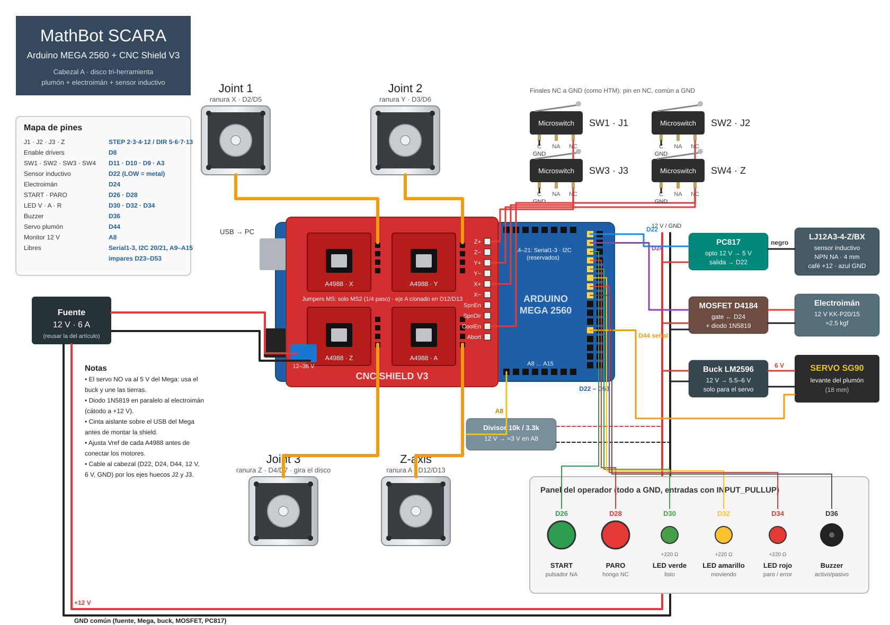

# Firmware MathBot · Arduino MEGA 2560

La CNC Shield V3 se monta sobre el Mega igual que sobre el UNO: los pines D2–D13 y A0–A3 coinciden,
así que motores y finales de carrera quedan como en el artículo de HowToMechatronics. Lo que agrega
el cabezal de disco va a los pines que solo tiene el Mega.

| Función | Pin | Notas |
|---|---|---|
| J1 · J2 · J3 · Z (STEP / DIR) | 2/5 · 3/6 · 4/7 · 12/13 | ranuras X, Y, Z, A (eje A clonado en D12/D13) |
| Enable de los 4 drivers | D8 | LOW = energizados |
| Finales SW1 J1 · SW2 J2 · SW3 J3 · SW4 Z | D11 · D10 · D9 · A3 | NC a GND, como HTM |
| Sensor inductivo (vía PC817) | D22 | LOW = metal |
| Electroimán (módulo MOSFET D4184) | D24 | diodo 1N5819 en paralelo a la bobina |
| START · PARO | D26 · D28 | NA a GND · hongo NC a GND |
| LED verde · amarillo · rojo | D30 · D32 · D34 | con 220 Ω |
| Buzzer | D36 | |
| Servo SG90 del plumón | D44 | alimentado por el buck a 5.5–6 V, no por el Mega |
| Monitor de 12 V | A8 | divisor 10 kΩ / 3.3 kΩ |
| Libres | Serial1–3, I2C 20/21, A9–A15, impares D23–D53 | HC-05, STS3215, AS5600, LCD |

Microstepping: jumper **solo en MS2** de cada driver (1/4 de paso, el que usa `python/scara_modelo.py`).

## Versiones por etapa

El robot se arma por partes, así que el firmware también: cada etapa tiene su sketch y solo pide el
hardware que ya está montado. No hay que pasar a la siguiente hasta que la anterior funcione.

| Etapa | Sketch | Qué necesita montado | Qué comprueba |
|---|---|---|---|
| 1 · Motores | `prueba_nema/` | Mega + shield + drivers + NEMA sueltos sobre la mesa, 12 V | Cada motor ida y vuelta, luego X+Y+Z juntos. Sin bibliotecas, finales ni PARO. Ajusta Vref antes |
| 2 · Preliminar | `prueba_componentes/` y `prueba_servo/` | Lo anterior + finales, sensor, electroimán, botones, LED, buzzer, divisor de 12 V, servo | Menú uno por uno: sentido de giro (`INVERTIR_DIR`), finales, sensor, imán, 12 V. `prueba_servo` da los ángulos ARRIBA/ABAJO |
| 3 · Disco | `prueba_cabezal/` | Brazo 2 + J3 + cabezal v3 con sus tres herramientas en un soporte | Homing de J3 y dónde dispara su final, cambio de herramienta, 18 mm de levante del plumón (`c 20`), agarre del imán, distancia de detección del sensor, que nada roce al girar |
| 4 · Robot completo | `mathbot_mega/` (v3.0) | Todo el SCARA | Homing, jog, puntos, rosa y misión; se maneja desde el [panel de operario](../panel/README.md) o el Monitor Serie |

Lo que sale de cada etapa se pasa a la siguiente por `CFG` (sin recompilar): `home3` (ángulo donde
dispara el final de J3, etapa 3), `servoup` / `servodn` (etapas 2–3), `inv` (bits de sentido, etapa 2).

Necesitan la biblioteca **AccelStepper** (Gestor de bibliotecas). Placa: *Arduino Mega or Mega 2560*.
Monitor Serie a 115200 con fin de línea "Nueva línea".

## Protocolo de `mathbot_mega` (v3.0)

Una orden por línea, en ASCII. El panel antepone `#n ` y el Mega contesta con el mismo número:
`ok n` o `err n motivo`. Escrito a mano en el Monitor Serie funciona igual sin el prefijo.

| Orden | Qué hace |
|---|---|
| `?` | identificación `I MATHBOT 3.0 ...` (geometría y límites), configuración `C ...` y puntos |
| `H [j1\|j2\|j3\|z]` | homing con finales (todos: Z, J3, J2, J1; o un eje). Si ya había home, avisa `E DERIVA eje mm/°` |
| `S [t1 t2 phi z]` | home manual: la pose actual pasa a ser esa (sin números: J1–J3 = 0 y Z la que tenía, o `home4` si no la sabía) |
| `O 0` / `O 1` | soltar / energizar los drivers (los 4 a la vez: EN es común en D8) |
| `J eje d` | jog: `1..4` (J1–J3 en °, Z en mm) o `x` `y` `z` (punta, mm). Sin home solo el articular, sin límites |
| `T p\|i\|s` | herramienta activa: plumón, electroimán, sensor (gira J3) |
| `M x y` · `L x y` | mover la herramienta a (x, y) en articular · en línea recta a la velocidad de trazo |
| `Z z` · `ZT h` | altura de la plataforma · punta de la herramienta a h mm sobre la mesa |
| `A t1 t2 phi z` | ángulos directos |
| `P 1\|0` · `E 1\|0` · `V v` | plumón abajo/arriba · electroimán · velocidad de trazo (mm/s) |
| `PT` · `PT n x y h` · `PT n` · `PTB n` · `G n` | listar · guardar punto (o la punta actual) · borrar · ir al punto |
| `X` · `K` · `D` · `D?` · `R` | escanear puntos · recoger metálicas · trazar la rosa · comprobar la rosa · misión completa |
| `CFG [clave valor]` | ver / cambiar: `home1..4 zmesa rosax rosay rosaa binx biny binh vel servoup servodn inv finales cabezal` |
| `GUARDAR` · `CARGAR` · `FABRICA` | EEPROM: guardar la configuración y los puntos · releer · valores de fábrica |
| `C` | limpiar el paro (obliga a repetir el home) |
| `!` | paro inmediato, en cualquier momento, incluso a mitad de otra orden |

Lo que manda el Mega sin que se lo pidan:

- `S est t1 t2 phi z herr pluma iman metal 12V finales`, 5 Hz moviéndose y 2 Hz quieto. `est`: `R` listo,
  `H` listo con home manual, `N` sin home, `M` moviéndose, `L` motores sueltos, `P` en paro.
- `E FASE escaneo|recoleccion|rosa|regreso`, `E METAL n 0|1`, `E DERIVA eje d`, `E FIN segundos`, `E PARO motivo`.
- `L texto`: mensajes para el registro.

## Limitaciones a tener en cuenta al probar

- **Abrir el puerto reinicia el Mega** (DTR). Conectar el panel a mitad de una misión la corta. Durante
  el reinicio (~1 s) D8 queda flotando y los drivers se sueltan: el firmware los energiza en la primera
  línea de `setup()`, pero **la plataforma Z baja un poco cada vez**. Antes de conectar, Z arriba o sobre algo.
- **Z cae con los motores sueltos**: el husillo Tr8×8 no es autobloqueante. `O 0` y el home manual la dejan
  caer; el paro por software la sostiene. Un corte de 12 V también la suelta: deja un tope o un bloque bajo
  la plataforma en las pruebas.
- **El hongo de PARO solo es software**: si el Mega se cuelga no detiene nada. Para la versión final, que el
  hongo corte los 12 V de los drivers con un relé o contactor (y aceptar que Z baje).
- **Posición estimada**: el Mega cuenta pasos, no los mide. Si un motor salta pasos la posición mostrada
  miente hasta el próximo `H`; `E DERIVA` dice cuánto se había perdido.
- **CPU**: AccelStepper da ~4000 pasos/s en total en el Mega. Por eso las velocidades son modestas y el
  estado sale a 5 Hz como máximo; el panel interpola entre lecturas.
- **Serie**: 64 bytes de buffer. El panel manda una orden y espera su `ok` antes de la siguiente; no
  pegues varias líneas de golpe en el Monitor Serie.
- **EEPROM**: ~100 000 escrituras. `CFG` y `PT` cambian la RAM; solo `GUARDAR` escribe.
- **12 V**: el estado los reporta (divisor en A8) y el homing avisa si no los detecta (< 10.5 V): sin ellos
  el Mega cuenta pasos que los motores no dan.

## Simular en Wokwi

1. Abre <https://wokwi.com/projects/new/arduino-mega>.
2. Pestaña `diagram.json`: reemplaza todo por `wokwi/diagram.json`.
3. Library Manager → agrega **AccelStepper** (o crea `libraries.txt` con el de `wokwi/`).
4. Pestaña `sketch.ino`: pega el sketch que quieras probar y cambia `SIMULACION = true`
   (en Wokwi los finales de carrera son pulsadores NA).
5. Play. Comandos útiles en `mathbot_mega`: `S` (home manual), `?`, `T s`, `M 200 -100`, `D?`, `D`, `R`.
   Para probar el homing con `H`, pulsa SW4, SW3, SW2 y SW1 en ese orden mientras cada motor gira.

En la simulación el electroimán es el LED morado, el sensor es el pulsador azul "Sensor: metal"
(mantenlo apretado durante el escaneo para marcar una pieza como metálica), el PARO es el interruptor
deslizante y el potenciómetro hace de divisor de 12 V. El servo se alimenta del 5 V solo en Wokwi.
